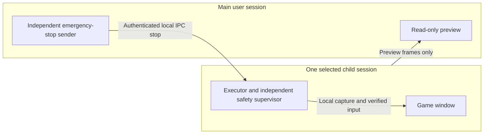

# Independent ChildSession backend

**Status: disabled-by-default contract/probe prototype, not a working desktop-duplication controller.** Native session creation, RDP ActiveX connection, preview, cross-process stop transport, remote input and held-input release are not implemented or tested. Imports and the offline CLI do not query Windows. All live game/window/capture/input/login tests remain paused by user instruction.

This is the independent isolation route requested alongside ordinary native Win32 capture. It follows the Windows ChildSession concept also used by BetterGI's desktop-duplication feature. It is original Python code based on public API documentation; no BetterGI GPL implementation or resource was copied. BetterGI is not an installed dependency of this backend. A UI card's promise of avoiding mouse occupation is not evidence that this Windows build, game or backend satisfies the requirement.

The [offline control core](CHILD_SESSION_CONTROL.md) provides authenticated control envelopes, heartbeat/lease deadlines, stop generations, same-session checks and owned-input cleanup. It supports explicit synthetic ports only; all native/IPC paths remain unconnected and no live-test gate has passed.

## Separation and process placement



The game and executor must have the same child-session ID, different from the main-session ID. Fresh process/window identity must be established **inside that child session**; a host HWND or old PID is not a cross-session binding. The main session receives preview frames and exposes stop controls only. It must never relay pointer/keyboard/game-mouse events into the RDP control or silently fall back to the ordinary Win32/SendInput path.

Microsoft describes a child session as a loopback RDP session tied to an existing user session, not a VM. Only one active connected child session is supported. Child sessions do not provide an independent lock screen, and termination/lifetime behavior must be considered before proposing activation. These platform facts do not establish game compatibility.

## Independent configuration and interface

`config/child_session.json` is separate from `config.json`. `ChildSessionConfig` strictly validates booleans, timeouts and known keys. Defaults are disabled, read-only main preview, no preview input/fallback, same-child-session requirement and authenticated stop IPC. Attempts to weaken these invariants or insert credential fields are rejected. Setting `enabled=true` is not startup authorization and cannot make the unimplemented transport operational.

`backends.child_session.ChildSessionBackend` exposes:

| Method | Implemented behavior | What it does not claim |
|---|---|---|
| `assess(facts, observations)` | Reports independent checks, missing/failed/stale evidence and implementation/startup blockers | It never returns `operational=true` or input permission, even with all-positive supplied facts |
| `open()` | Explicit blocked result, connected false | No enabling API, account operation, ActiveX connection or process launch |
| `capture_one()` | Unavailable result with null frame/image | No synthetic image or host-capture substitution |
| `send_action(intent)` | Blocked, sent false, main-desktop fallback false | No native input call or hidden delegation to the Win32 backend |
| `stop_local()` | Increments stop generation and latches local permission revocation | No cross-process delivery, remote key release or session shutdown acknowledgment |

Capture, click, drag, keyboard, main-desktop noninterference, authenticated stop delivery, remote release, heartbeat watchdog and independent stop-hotkey evidence are separate. Test-scope evidence cannot pass a live gate. Supplied live-test labels remain caller assertions and cannot substitute for a native transport implementation, startup authorization or independent review.

`probe_platform()` defaults to `not_probed`. A future explicitly permitted read-only probe can load the Windows WTS API, check exports and call only `WTSIsChildSessionsEnabled` and `WTSGetChildSessionId`. The no-child sentinel is normalized to unknown/no selected child. Merely finding `WTSEnableChildSessions` is not calling it. This function is not wired to the offline CLI or invoked on import. Current tests inject fake API objects; no native probe was run during this change.

## Offline commands

From the repository root:

```powershell
python -B -m backends.child_session
python -B -m backends.child_session --synthetic-supported
python -B -m unittest test_child_session -v
```

The first report is disabled. The second uses invented session facts and still reports blocked/nonoperational. Successful completion of this diagnostic command means a report was produced, not that a backend connected or an isolated action succeeded. No real-session inventory is used.

## Stop protocol and future transport boundary

`stop_protocol.py` implements a bounded JSON/HMAC-SHA256 stop-message codec, session token binding, strictly increasing sequence, time validity and replay rejection. It accepts only `stop`; malformed, duplicate-field, modified, foreign-session, future/stale and oversized messages are rejected. A valid message revokes the local backend generation and latches stopped. Receipts explicitly retain `transport_delivered=false` and `remote_release_confirmed=false` because this is a local protocol state machine, not a running IPC endpoint.

A future transport should use a local named pipe with a restrictive user/process/session ACL, peer-session checks and ephemeral per-connection keys/tokens. Do not expose a network listener, log keys, persist credentials or trust a predictable pipe name as authentication. Both ends must rotate connection identity on restart. Loss of authenticated heartbeat/pipe connection must revoke the execution lease. Stop processing must be independent of OCR and short cancellable waits must bound new sends. A local queue acknowledgment is insufficient: remote release needs its own verified receipt tied to the stop generation and worker identity.

The future child worker must clear queued actions and release only its own held-input ledger on stop/disconnect/error, with no host-side blanket key-up. A main-session stop hotkey and child-local emergency mechanism must function even when preview/capture is blocked. None of those native/transport behaviors are implemented by this codec.

## Authorization and acceptance gates

No current startup authority is present. Before any enabling call, ActiveX connection, credential/UAC step or system/network/security change, present the specific required action and rollback for user authorization. Authentication remains manual. Do not enable RDP, change firewall/services/security settings, create accounts, install patches/drivers, use RDPWrap or invoke BetterGI's security-workaround instructions automatically.

When live testing is explicitly resumed, first inventory components and existing sessions read-only, without replacing an existing child session. An API-availability result does not grant activation authority. Verify game/build compatibility and resource/GPU behavior; no RAM/VRAM figure or edition compatibility is guaranteed.

The first allowed isolation experiment should use an owned harmless test window, before a custom-room game test. Verify click/drag/keyboard and stop/disconnect behavior while the main desktop remains usable, including the pointer entering/leaving/crossing the preview rectangle. Any host cursor, keyboard or focus interference fails unattended acceptance. Do not hide it with pointer locking, focus stealing or foreground fallback. Game testing remains limited to separately authorized custom-room actions.

## Provenance and version boundaries

- [Microsoft Child Sessions](https://learn.microsoft.com/en-us/windows/win32/termserv/child-sessions), [WTSIsChildSessionsEnabled](https://learn.microsoft.com/en-us/windows/win32/api/wtsapi32/nf-wtsapi32-wtsischildsessionsenabled), and [WTSGetChildSessionId](https://learn.microsoft.com/en-us/windows/win32/api/wtsapi32/nf-wtsapi32-wtsgetchildsessionid): API design references only; no Microsoft sample implementation was copied.
- [Pinned BetterGI session documentation](https://github.com/huiyadanli/bettergi-docs/blob/f39308e9f33afcdb289efe8780081fe715787679/src/feats/command/session.md): design reference. Its game-mouse mode can capture the main pointer and is outside this backend's required preview-only mode. Its setup workarounds are not authorization to alter security settings.
- [BetterGI research commit b3f90e70494320639eeccc8c559612d02d2d9ef0](https://github.com/babalae/better-genshin-impact/tree/b3f90e70494320639eeccc8c559612d02d2d9ef0): design reference only, not linked/copied. Reviewed stable [0.66.0](https://github.com/babalae/better-genshin-impact/releases/tag/0.66.0) lacks the WatchMode present in that main-branch review; do not assume a stable-package preview feature is available.
- [BetterGI issue #3631](https://github.com/babalae/better-genshin-impact/issues/3631#issuecomment-5575963320): a reported host-pointer interference condition to test, not proof of universal failure or a confirmed fix.

See [THIRD_PARTY_NOTICES.md](../THIRD_PARTY_NOTICES.md). This backend adds no third-party package, native binary or GPL code dependency. The project's own license remains undecided.
